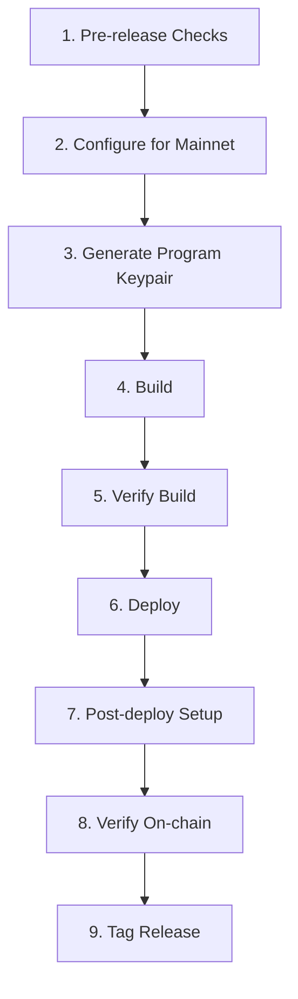

# Release Procedure - Proof of Reserves (Mainnet)

Fresh deployment of the Proof of Reserves program to Solana mainnet-beta.

## Overview



## Prerequisites

- Anchor CLI v0.31.1 (`anchor --version`)
- Solana CLI v2.1.x (`solana --version`)
- Mainnet RPC endpoint (preferably a dedicated RPC, not the public one)
- Funded deployer wallet (at minimum ~5 SOL for program deployment + rent)
- `INIT_AUTHORITY` keypair accessible for the `initialize` transaction
- Chainlink verifier and access controller programs must already be deployed on mainnet

## 1. Pre-release Checks

### 1.1 Clean working tree

```bash
git status  # must be clean, no uncommitted changes
```

### 1.2 Run tests

```bash
anchor test
```

All tests must pass before proceeding.

### 1.3 Review security-critical values

Verify the following in `programs/proof-of-reserves/src/lib.rs`:

| Constant | Description | Action |
|---|---|---|
| `INIT_AUTHORITY` (line 16) | Pubkey allowed to call `initialize` | Set to the mainnet admin pubkey |
| `declare_id!` (line 14) | On-chain program ID | Will be updated in step 3 |

Verify Chainlink dependency pinning in `programs/proof-of-reserves/src/instructions.rs`:

| Check | Location |
|---|---|
| `verifier::ID` constraint | `Verify` account struct (line 400) - must match the mainnet Chainlink verifier program |

## 2. Configure for Mainnet

### 2.1 Update `INIT_AUTHORITY`

Edit `programs/proof-of-reserves/src/lib.rs` line 16-17:

```rust
const INIT_AUTHORITY: Pubkey =
    Pubkey::from_str_const("<MAINNET_ADMIN_PUBKEY>");
```

### 2.2 Update `Anchor.toml`

Add a mainnet program entry and set the provider:

```toml
[programs.mainnet]
proof_of_reserves = "<PROGRAM_ID>"  # from step 3

[provider]
cluster = "mainnet"
wallet = "<PATH_TO_DEPLOYER_WALLET>"
```

### 2.3 Prepare deployer wallet

```bash
# Set CLI to mainnet
solana config set --url <MAINNET_RPC_URL>

# Verify the deployer wallet has enough SOL
solana balance <PATH_TO_DEPLOYER_WALLET>
```

The deployer wallet needs enough SOL to cover:
- Program deployment rent (~3-4 SOL depending on binary size)
- Transaction fees

## 3. Generate Program Keypair

Generate a vanity keypair or use an existing one for the program address:

```bash
# Option A: generate a new keypair
solana-keygen new -o .secrets/program-keypair.json

# Option B: use a vanity keypair (if you have one)
# solana-keygen grind --starts-with PoR:1
```

Then update `declare_id!` in `programs/proof-of-reserves/src/lib.rs` (line 14):

```rust
declare_id!("<NEW_PROGRAM_ID>");
```

And update `Anchor.toml`:

```toml
[programs.mainnet]
proof_of_reserves = "<NEW_PROGRAM_ID>"
```

## 4. Build

```bash
anchor build -- --features mainnet
```

This produces:
- `target/deploy/proof_of_reserves.so` - the compiled program
- `target/idl/proof_of_reserves.json` - the IDL
- `target/types/proof_of_reserves.ts` - TypeScript types

### 4.1 Verify program ID in build output

```bash
anchor keys list
```

The output must match the `declare_id!` value and `Anchor.toml` entry.

## 5. Verify Build

### 5.1 Check binary size

```bash
ls -lh target/deploy/proof_of_reserves.so
```

Solana programs have a max size of ~10MB. Verify the binary is within limits.

### 5.2 Verify the program keypair matches

```bash
solana-keygen pubkey .secrets/program-keypair.json
# Must match declare_id! value
```

### 5.3 Inspect the IDL

```bash
cat target/idl/proof_of_reserves.json | jq '.instructions[].name'
```

Expected instructions:
- `initialize`
- `setAppConfig`
- `setPendingAuthority`
- `acceptAuthority`
- `issue`
- `redeem`
- `depositMintAuthority`
- `withdrawMintAuthority`
- `depositFreezeAuthority`
- `withdrawFreezeAuthority`
- `freezeTokenAccount`
- `thawTokenAccount`
- `verify`

## 6. Deploy

### 6.1 Deploy the program

```bash
anchor deploy \
  --provider.cluster mainnet \
  --provider.wallet <PATH_TO_DEPLOYER_WALLET> \
  --program-keypair .secrets/program-keypair.json
```

If the deployment is too large for a single transaction, use the buffer approach:

```bash
# Write program to a buffer first
solana program write-buffer target/deploy/proof_of_reserves.so

# Deploy from buffer
solana program deploy \
  --buffer <BUFFER_ADDRESS> \
  --program-id .secrets/program-keypair.json \
  --keypair <PATH_TO_DEPLOYER_WALLET> \
  --url <MAINNET_RPC_URL>
```

### 6.2 Transfer upgrade authority (if applicable)

After deploy, the deployer wallet holds the upgrade authority. Transfer it to the intended authority or revoke it:

```bash
# Option A: transfer to a multisig or governance
solana program set-upgrade-authority <PROGRAM_ID> \
  --new-upgrade-authority <MULTISIG_ADDRESS> \
  --keypair <PATH_TO_DEPLOYER_WALLET>

# Option B: make immutable (irreversible - cannot upgrade ever)
solana program set-upgrade-authority <PROGRAM_ID> \
  --final \
  --keypair <PATH_TO_DEPLOYER_WALLET>
```

## 7. Post-deploy Setup

### 7.1 Initialize the program

Call the `initialize` instruction with the `INIT_AUTHORITY` keypair:

- Signer: `INIT_AUTHORITY` keypair
- `u`: the U token mint address on mainnet
- `feed_id`: the Chainlink feed ID for reserves (32 bytes)

### 7.2 Configure authorities

Call `set_app_config` to set the production authorities and fee rates:

| Parameter | Description |
|---|---|
| `new_issuance_fee_rate` | Basis points (0-10000) |
| `new_redemption_fee_rate` | Basis points (0-10000) |
| `new_issue_authority` | Pubkey for issuance operations |
| `new_redeem_authority` | Pubkey for redemption operations |
| `new_update_authority` | Pubkey for reserve verification |
| `new_freeze_authority` | Pubkey for freeze/thaw operations |
| `feed_id` | Chainlink feed ID (32 bytes) |

### 7.3 Deposit mint authority

Transfer the U token mint authority to the config PDA:

```
Call: deposit_mint_authority
Signer: current U token mint authority
```

### 7.4 Deposit freeze authority (if needed)

```
Call: deposit_freeze_authority
Signer: current U token freeze authority
```

### 7.5 Verify initial reserve state

Call `verify` with a fresh Chainlink report to populate the reserves PDA.

## 8. Verify On-chain

### 8.1 Confirm program deployment

```bash
solana program show <PROGRAM_ID> --url <MAINNET_RPC_URL>
```

Check:
- Program is deployed and executable
- Upgrade authority is set correctly
- Data length is reasonable

### 8.2 Confirm PDA accounts

```bash
# Config PDA
solana account <CONFIG_PDA_ADDRESS> --url <MAINNET_RPC_URL>

# Reserves PDA
solana account <RESERVES_PDA_ADDRESS> --url <MAINNET_RPC_URL>
```

### 8.3 Verify IDL upload (optional)

```bash
anchor idl init <PROGRAM_ID> \
  --filepath target/idl/proof_of_reserves.json \
  --provider.cluster mainnet \
  --provider.wallet <PATH_TO_DEPLOYER_WALLET>
```

## 9. Tag Release

### 9.1 Commit mainnet configuration

```bash
git add programs/proof-of-reserves/src/lib.rs Anchor.toml
git commit -m "Configure for mainnet deployment"
```

### 9.2 Create a git tag

```bash
git tag -a v1.0.0 -m "Mainnet release - Proof of Reserves v1.0.0

Program ID: <PROGRAM_ID>
Network: mainnet-beta
Deployer: <DEPLOYER_PUBKEY>
INIT_AUTHORITY: <INIT_AUTHORITY_PUBKEY>"
```

### 9.3 Push

```bash
git push origin main --tags
```

### 9.4 Create GitHub release

```bash
gh release create v1.0.0 \
  target/deploy/proof_of_reserves.so \
  target/idl/proof_of_reserves.json \
  --title "v1.0.0 - Mainnet Release" \
  --notes "Program ID: <PROGRAM_ID>"
```

## Rollback

Since this is a fresh deploy, rollback options are limited:

1. **Before `initialize`**: The program is deployed but has no state. You can close the program buffer to reclaim SOL.
2. **After `initialize` but before `deposit_mint_authority`**: The program has a config PDA but no control over the token. The state is inert.
3. **After `deposit_mint_authority`**: The config PDA controls minting. To revert, call `withdraw_mint_authority` to reclaim mint authority, then close/abandon the program.

If the program has upgrade authority, you can deploy a patched version:

```bash
anchor upgrade target/deploy/proof_of_reserves.so \
  --program-id <PROGRAM_ID> \
  --provider.cluster mainnet \
  --provider.wallet <UPGRADE_AUTHORITY_WALLET>
```

## Checklist

Use this checklist to track progress during the release:

- [ ] All tests pass
- [ ] `INIT_AUTHORITY` set to mainnet admin pubkey
- [ ] `declare_id!` set to program keypair pubkey
- [ ] `Anchor.toml` updated for mainnet
- [ ] Deployer wallet funded (>5 SOL)
- [ ] `anchor build -- --features mainnet` succeeds
- [ ] `anchor keys list` matches `declare_id!`
- [ ] IDL contains all 13 instructions
- [ ] Program deployed to mainnet
- [ ] Upgrade authority transferred or revoked
- [ ] `initialize` called successfully
- [ ] `set_app_config` called with production values
- [ ] `deposit_mint_authority` called
- [ ] `deposit_freeze_authority` called (if needed)
- [ ] Initial `verify` call succeeds
- [ ] Config PDA verified on-chain
- [ ] Reserves PDA verified on-chain
- [ ] Git tagged `v1.0.0`
- [ ] GitHub release created with `.so` and IDL artifacts
